# Biblioteca visual — como usar

Referência de design para **todo site novo e todo redesign** feito nesta pasta.

**Leitura obrigatória antes de propor direção visual e antes de escrever a
primeira linha de CSS.** Não é catálogo para admirar: é material de trabalho.
Cada referência aqui tem um print salvo em `prints/`, um uso adequado, as
decisões concretas que ela autoriza e o que dela **não** deve ser copiado.

Última verificação dos links e captura dos prints: **01/09/2026**.

---

## 1. O erro que este arquivo existe para evitar

Referência vira lixo de três jeitos:

1. **Referência por link.** Anotar "fazer tipo o Linear" e nunca abrir o print.
   Resultado: um dark mode genérico que não tem nada do Linear.
2. **Referência do tipo errado.** Copiar portfólio de estúdio premiado numa
   ferramenta de uso diário. O produto do estúdio **é** a experiência — 8 MB,
   shader, intro de 4 segundos. Ninguém aguenta isso na trigésima vez que abre
   o gerador de prompt.
3. **Referência sem tradução.** Olhar o print, dizer "bonito", e escrever CSS
   do jeito de sempre. Referência que não vira número (px, ms, peso, escala)
   não mudou nada.

---

## 2. O procedimento, em quatro passos

### Passo 1 — Escolher pelo tipo de projeto, não pelo gosto

| O que estou fazendo | Seção a usar |
|---|---|
| Landing page, campanha, vitrine, portfólio, página de lançamento | **Espetáculo** e **Premiados** |
| App, ferramenta, painel, jogo com UI, dashboard, site institucional | **Produto** |
| Site de **cliente real** | A identidade do cliente manda. As duas listas viram só vocabulário de execução — nunca fonte de direção. |

Se o projeto é usado **mais de uma vez pela mesma pessoa**, ele é Produto,
mesmo que seja bonito. Frequência de uso decide, não o assunto.

### Passo 2 — Analisar o print, não o link

Abrir o arquivo em `prints/` e olhar de verdade. Link é para conferir o site
vivo depois; a leitura é feita no print, porque é nele que dá para medir.

Para cada referência escolhida, responder estas cinco perguntas **por escrito**,
antes de propor qualquer coisa:

```
COMPOSIÇÃO   Quantas colunas? O que ocupa o maior bloco da tela?
             O que está nos cantos? Onde está o vazio e por que ele está lá?
TIPOGRAFIA   Quantas famílias? Qual a razão entre o maior e o menor tamanho?
             O peso é o contraste, ou é o tamanho? Onde entra mono/serifa?
ESPAÇAMENTO  O respiro é maior na vertical ou na horizontal?
             O grid é visível (linhas, marcadores) ou implícito?
COR          Quantas cores existem de fato? A cor está no fundo, no texto ou
             só na imagem? O que a cor de ação faz que nenhuma outra faz?
MOVIMENTO    O que se move, quando, e o que acontece se nada se mover?
             A animação está antes ou depois da primeira leitura?
```

Se a resposta de alguma pergunta for "não dá para saber pelo print", abrir o
site vivo — não inventar.

### Passo 3 — Traduzir em decisões concretas

A leitura acima vira uma lista de decisões **numéricas**, que já é o começo do
sistema pedido pela skill `direcao-visual`. Formato:

```
Do <referência>: <o que peguei> → <decisão no projeto>

Ex.: Do Produx: título gigante em peso leve → h1 em 96px/300, não 48px/700.
Ex.: Do Igloo: labels técnicos nos quatro cantos → metadados em mono 11px,
     tracking 0.08em, fixos no topo e no rodapé.
Ex.: Do Linear: frase de duas cores → primeira oração em branco puro,
     resto em cinza 60% — mesma fonte, mesmo tamanho.
```

Regra: **de cada referência sai no máximo três decisões.** Mais que isso não é
referência, é cópia. E de referências diferentes não podem sair decisões que
brigam entre si (grid rígido do Obys + diagonal do Iventions no mesmo layout
não funciona — escolher um).

### Passo 4 — Comparar o resultado com a referência no fim

Terminado o CSS, **capturar o resultado em 1440×900** (a skill `revisar-visual`
faz isso; ou `python .claude/referencias-visuais/capturar-print.py`) e colocar
o screenshot ao lado do print da referência. Perguntas objetivas:

- A **hierarquia** é tão clara quanto a da referência? Dá para dizer em meio
  segundo o que é a coisa mais importante da tela?
- O **respiro** é comparável, ou o meu está apertado? Medir: quanto sobra em
  volta do bloco principal na referência, quanto sobra no meu.
- O **contraste de escala** entre título e corpo é parecido? Se a referência
  usa 6× e o meu usa 1,8×, não peguei nada dela.
- A **cor** está fazendo o mesmo papel, ou eu só copiei o hex?
- Existe no meu **um elemento que só faz sentido neste projeto**? Se trocar o
  texto e virar o site de qualquer outra coisa, a direção falhou.

Só declarar pronto depois dessa comparação. E dizer à pessoa, em português
claro, o que foi puxado de qual referência — sem jargão de CSS.

---

## 3. Espetáculo — WebGL, shader, animação pesada

Portfólio de estúdio e experiência de marca. **Referência ótima para landing e
campanha; péssima para ferramenta de uso diário.**

### Lusion — https://lusion.co
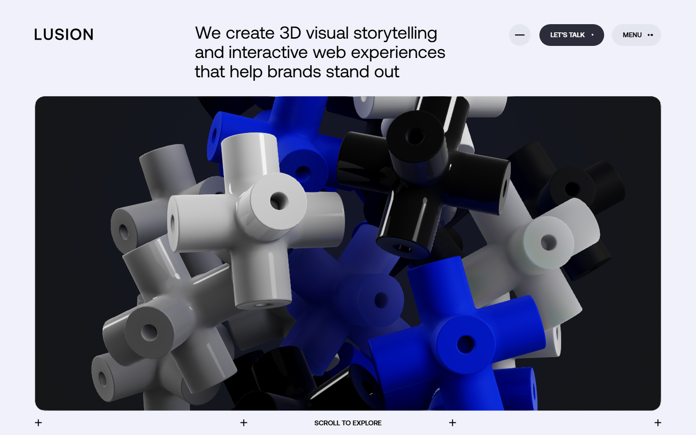

- **Usar quando:** o projeto tem um objeto/produto que merece ser o herói e há
  orçamento de peso para isso.
- **Decisões que inspira:** o herói é um **bloco de mídia emoldurado** com raio
  grande, ocupando ~90% da largura e deixando margem clara em volta, em vez de
  imagem sangrando a tela inteira; navegação em pills; marcadores `+` nos
  cantos do bloco tornando o grid explícito; tipografia neo-grotesca de peso
  médio (nada de black); fundo quase branco com leve tom frio.
- **Não copiar:** a cena 3D em tempo real. É o produto deles, não é decoração —
  em projeto pequeno isso vira 8 MB para dizer a mesma coisa que uma imagem.

### Obys Agency — https://obys.agency
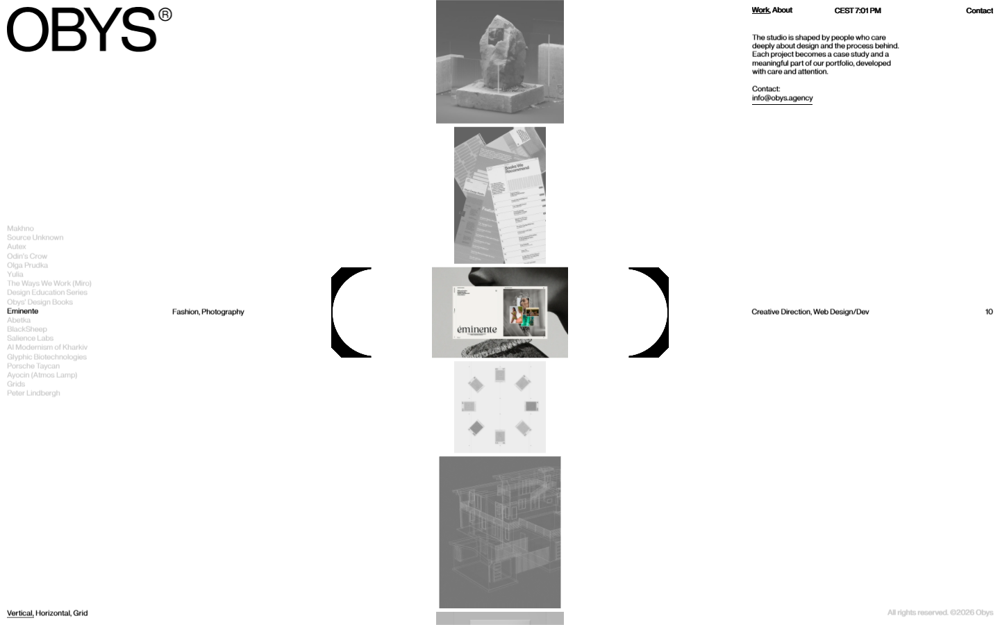

- **Usar quando:** o conteúdo é uma lista/portfólio e a composição editorial
  precisa carregar o peso visual.
- **Decisões que inspira:** índice textual à esquerda funcionando como
  navegação; coluna central estreita de imagens em preto e branco; alternador
  de layout (`Vertical, Horizontal, Grid`) no rodapé como recurso real, não
  enfeite; tudo em cinza, deixando cor só onde houver imagem colorida.
- **Não copiar:** o corpo de texto em ~11px e o cinza claro da lista de
  projetos. Bonito no print, ilegível para quem precisa usar.

### basement.studio — https://basement.studio
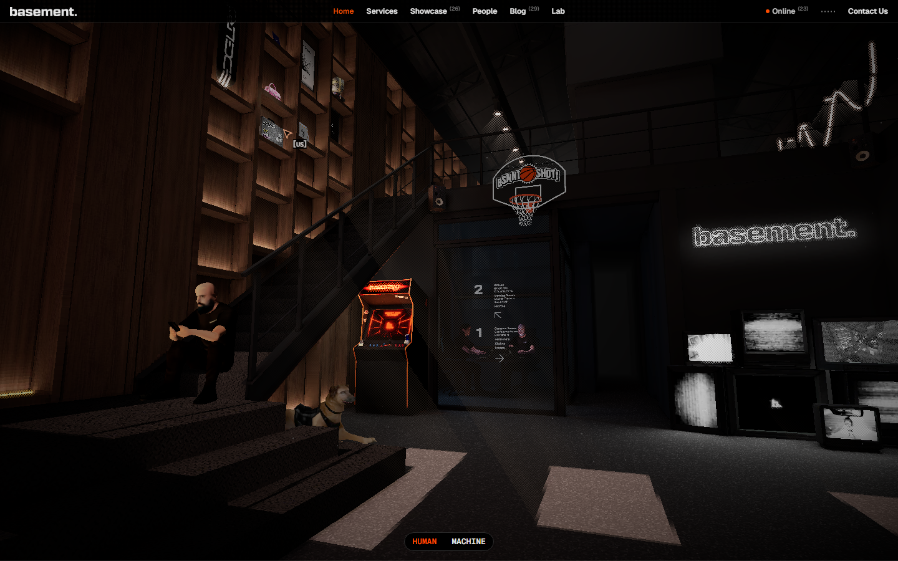

- **Usar quando:** o projeto tem personalidade própria e pode se dar ao luxo de
  ser engraçado.
- **Decisões que inspira:** **uma cena ilustrada única** como o elemento que só
  faz sentido naquele projeto (aqui, o porão com o arcade e o cachorro);
  contadores discretos ao lado dos itens de menu (`Showcase (26)`); toggle de
  modo no rodapé central.
- **Não copiar:** a nav clara por cima de cena escura sem faixa de proteção —
  no print, metade dos itens quase somem no fundo.

### Igloo Inc — https://igloo.inc
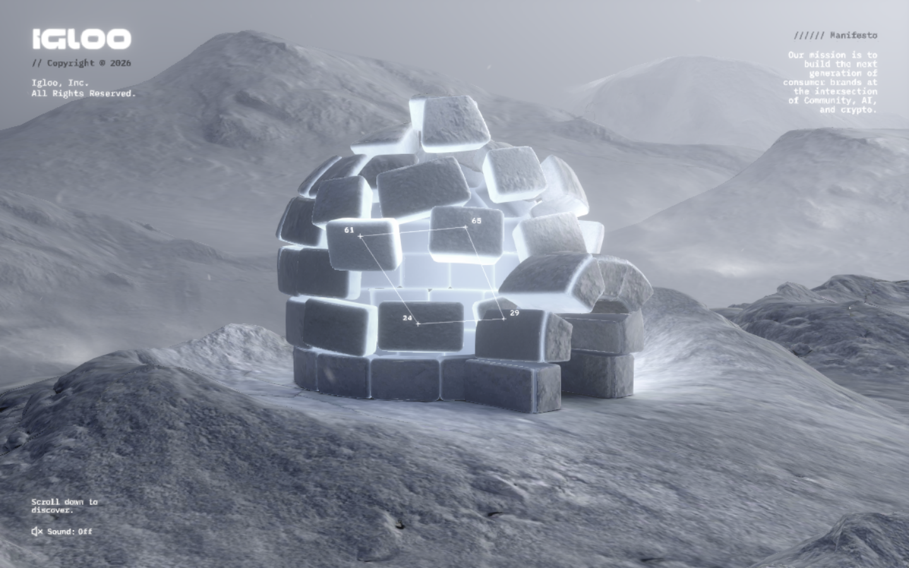

- **Usar quando:** existe um objeto único para mostrar e o clima é técnico,
  frio, silencioso. (É site de projeto cripto — olhar a execução, não o assunto.)
- **Decisões que inspira:** **HUD nos quatro cantos** — logo e copyright em
  cima à esquerda, manifesto em cima à direita, instrução de scroll embaixo;
  tudo em fonte mono; cotas e medidas desenhadas sobre o objeto; paleta
  monocromática para o objeto ser a única coisa com forma.
- **Não copiar:** som ligado por padrão e a narrativa longa presa ao scroll.

### By-Kin — https://by-kin.com/
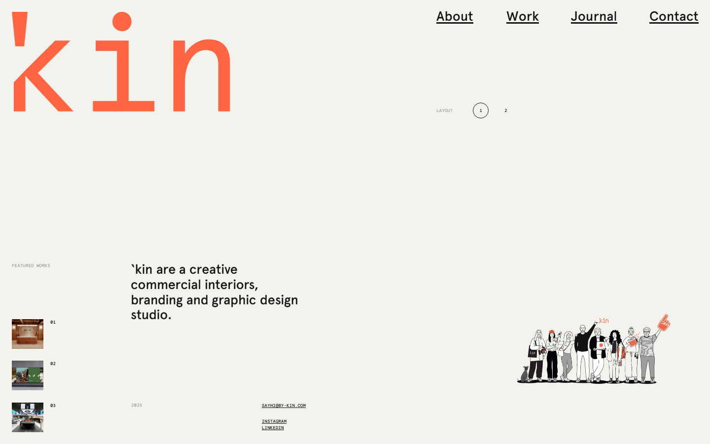

- **Usar quando:** marca pequena com um nome curto e bom, que aguenta virar
  elemento gráfico.
- **Decisões que inspira:** logotipo **gigante sangrando na margem esquerda**
  em vez de logo pequeno no canto; bege quente + um único laranja; miniaturas
  numeradas `01 02 03` numa coluna estreita; ilustração humana pontual num
  canto, sem moldura nem brilho em volta.
- **Não copiar:** a densidade baixíssima. Funciona com 4 informações na tela;
  com 20 vira desorganização.

### Iventions — https://iventions.com/
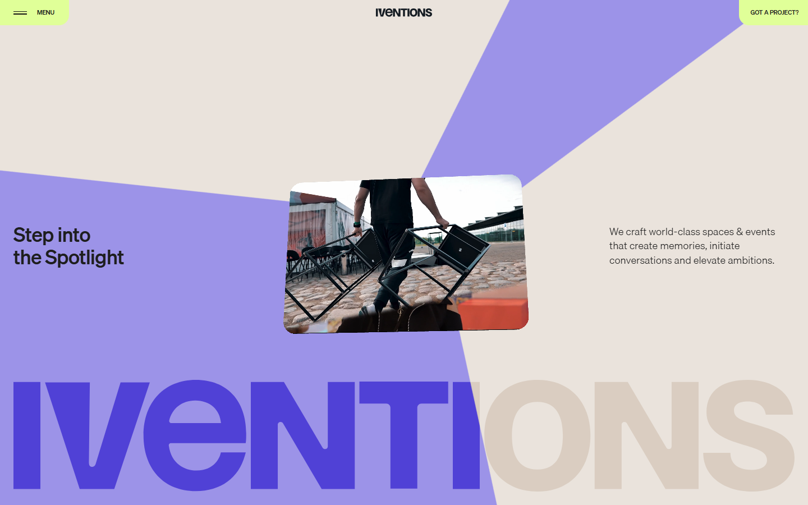

- **Usar quando:** o assunto é evento, festa, movimento — algo com energia.
- **Decisões que inspira:** fundo dividido em **diagonal** por duas cores
  chapadas; foto levemente rotacionada com cantos arredondados quebrando a
  diagonal; wordmark gigante cortado pela borda inferior; botões pill em
  verde-limão como única cor de ação.
- **Não copiar:** diagonal + rotação em site com muito texto. Cada elemento
  torto cobra imposto de leitura.

### Mat Voyce — https://matvoyce.tv
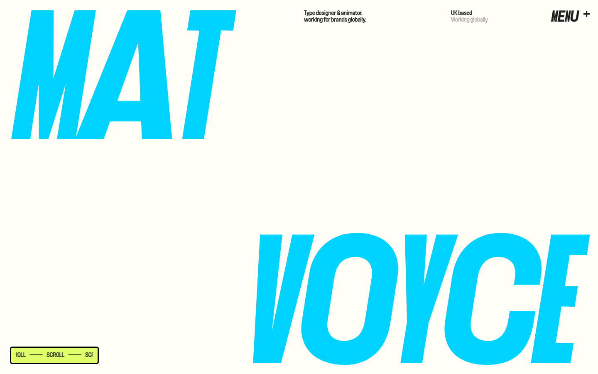

- **Usar quando:** a tipografia é o conteúdo.
- **Decisões que inspira:** duas palavras enormes em itálico pesado,
  **desalinhadas** (uma no topo à esquerda, outra embaixo à direita), criando
  uma diagonal sem desenhar diagonal nenhuma; ciano puro sobre creme, só isso;
  a etiqueta `SCROLL` como pílula gráfica no canto.
- **Não copiar:** duas cores e tipo gigante num site que precisa explicar algo.
  Aqui a mensagem inteira cabe em duas palavras.

### Minh Pham — https://minhpham.design/
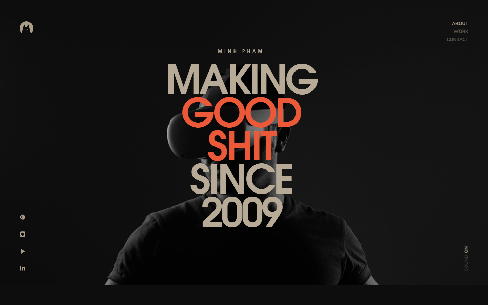

- **Usar quando:** existe uma boa foto escura e a headline precisa de atitude.
- **Decisões que inspira:** headline empilhada em 4 linhas com **uma palavra em
  cor** e o resto em bege; foto escurecida ao fundo sem overlay chapado (a
  própria foto já é escura); ícones sociais em coluna vertical à esquerda.
- **Não copiar:** o portão `START` antes do conteúdo — ver seção 6.

> **Active Theory** (https://activetheory.net) também é referência desta seção,
> mas **não tem print válido** — ver seção 7.

---

## 4. Premiados recentes — Awwwards, agosto/2026

Site premiado envelhece rápido. Esta lista é do momento; o valor dela é o
**print**, que continua servindo mesmo quando o site sair do ar ou mudar.

### ERA Residence — https://www.era-residence.com/
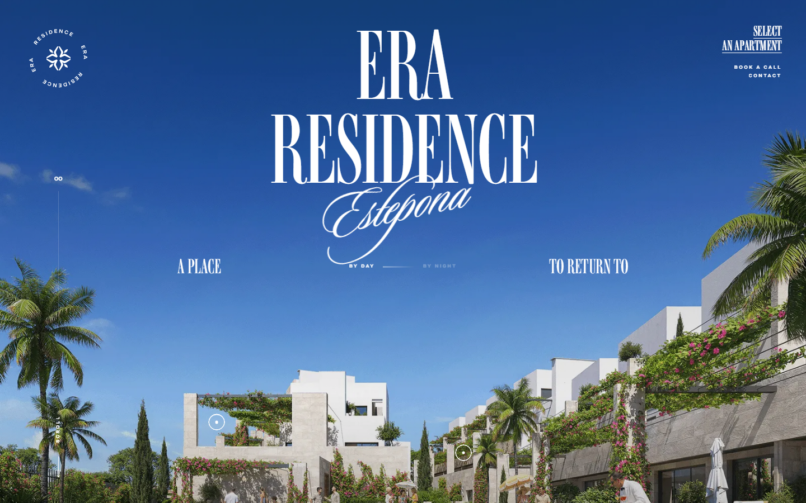

- **Usar quando:** imóvel, hotelaria, produto caro, algo aspiracional com foto boa.
- **Decisões que inspira:** serifa display alta e fina para o nome + **script
  só na assinatura** (a palavra "Estepona"), nunca no corpo; toggle
  `BY DAY / BY NIGHT` como um controle real que muda a foto; selo circular com
  texto em arco como marca-d'água; foto ocupando os 60% de baixo, céu limpo
  segurando o título em cima.
- **Não copiar:** script para qualquer coisa além de uma palavra de assinatura.

### Aardvark Book Club — https://aardvarkbookclub.com
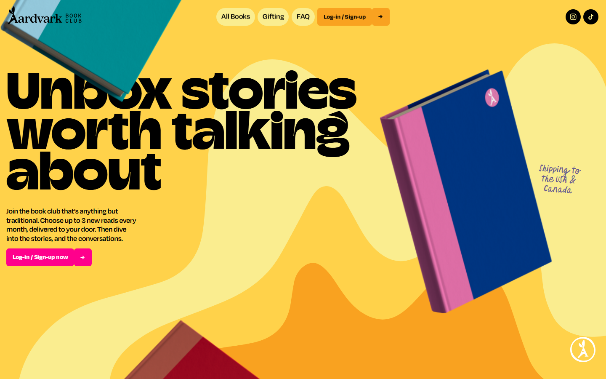

- **Usar quando:** produto físico, clube, assinatura, algo alegre e barato de
  produzir (formas + renders simples, sem estúdio fotográfico).
- **Decisões que inspira:** fundo amarelo com **blobs orgânicos em dois tons do
  mesmo amarelo** (textura sem imagem); grotesca pesada e arredondada no título;
  produtos flutuando em 3D leve, rotacionados; uma anotação manuscrita como
  detalhe secundário; botões pill em rosa e laranja fortes.
- **Não copiar:** parágrafo longo em preto sobre amarelo saturado — cansa a
  vista rápido. Título pode; texto corrido, não.

### Decathlon Yestalgia — https://decathlonyestalgia.com/
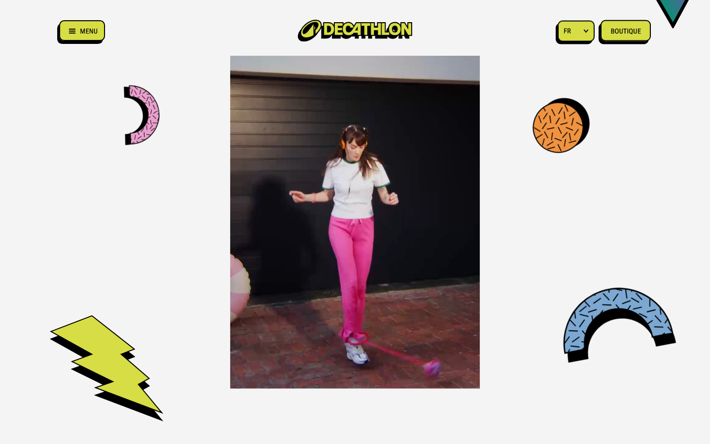

- **Usar quando:** campanha com vídeo vertical (conteúdo de celular) no centro.
- **Decisões que inspira:** **sombra dura sem blur** e borda preta grossa em
  botões e cards; adesivos avulsos (raio, arcos hachurados) espalhados sem
  simetria; vídeo vertical 9:16 como herói, centralizado, com fundo cinza claro
  neutro em volta.
- **Não copiar:** o vocabulário anos-90 quando a marca não pede. Aqui é
  intencional (o nome é *Yestalgia*); aplicado por reflexo vira fantasia.

### State of AI in Design 2026 — https://stateofaidesign.com/
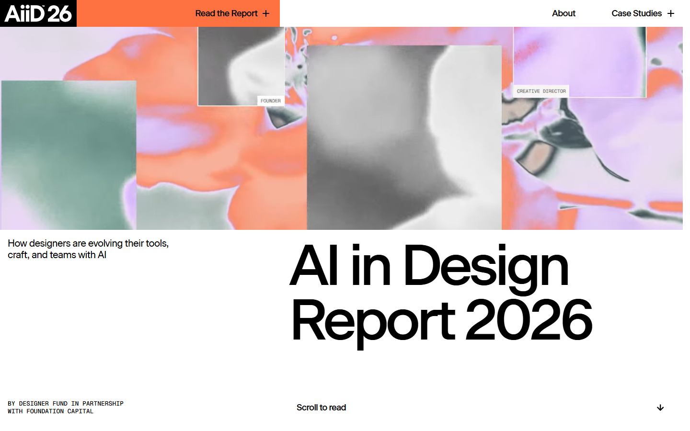

- **Usar quando:** relatório, artigo longo, conteúdo editorial que precisa de
  capa forte.
- **Decisões que inspira:** **assimetria deliberada** — legenda pequena embaixo
  à esquerda contra título gigante à direita; faixa de imagens degradê
  ocupando a metade de cima como textura, com rótulos (`FOUNDER`,
  `CREATIVE DIRECTOR`) em caixinhas brancas sobre elas; mono só para créditos e
  metadados; `Scroll to read` centralizado no rodapé com seta.
- **Não copiar:** nada crítico. É a referência mais segura desta seção para
  conteúdo de leitura.

### Vero — https://verostudio.com/
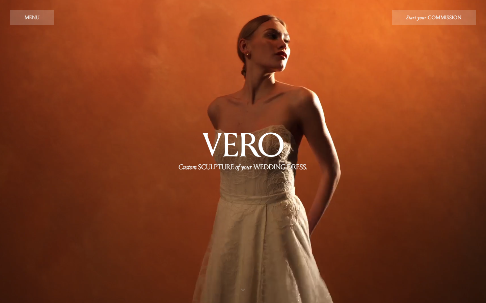

- **Usar quando:** moda, casamento, artesanato — algo com pele, tecido, luz quente.
- **Decisões que inspira:** **mistura tipográfica numa linha só** — itálico
  ("Custom"), versalete ("SCULPTURE"), itálico de novo ("of your"), versalete
  ("WEDDING DRESS"); serifa clássica em caixa alta para a marca; vídeo em tela
  cheia com dominante quente única; menu e CTA em pílulas translúcidas discretas
  nos cantos.
- **Não copiar:** vídeo autoplay em tela cheia sem alternativa — pesa e some no
  celular em rede ruim.

### NOTHIN' — https://www.noth.in
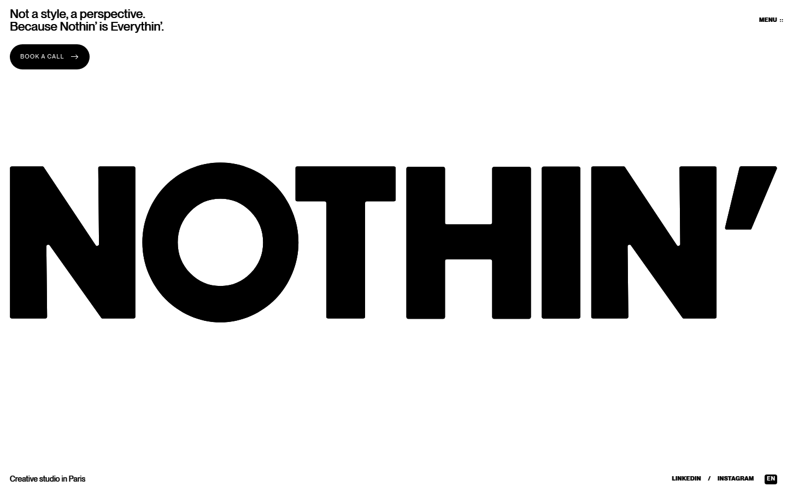

- **Usar quando:** o nome da marca é curto e a proposta é radicalmente direta.
- **Decisões que inspira:** **contraste brutal de escala** — texto de apoio em
  ~16px contra wordmark de ~300px na mesma tela; preto e branco, sem terceira
  cor; informação empurrada para os quatro cantos e o meio inteiro entregue à
  palavra; botão pill preto com seta como único ponto de ação.
- **Não copiar:** essa escala com nome longo. Quebra a palavra e vira sopa.

### Produx Design — https://www.produx.design
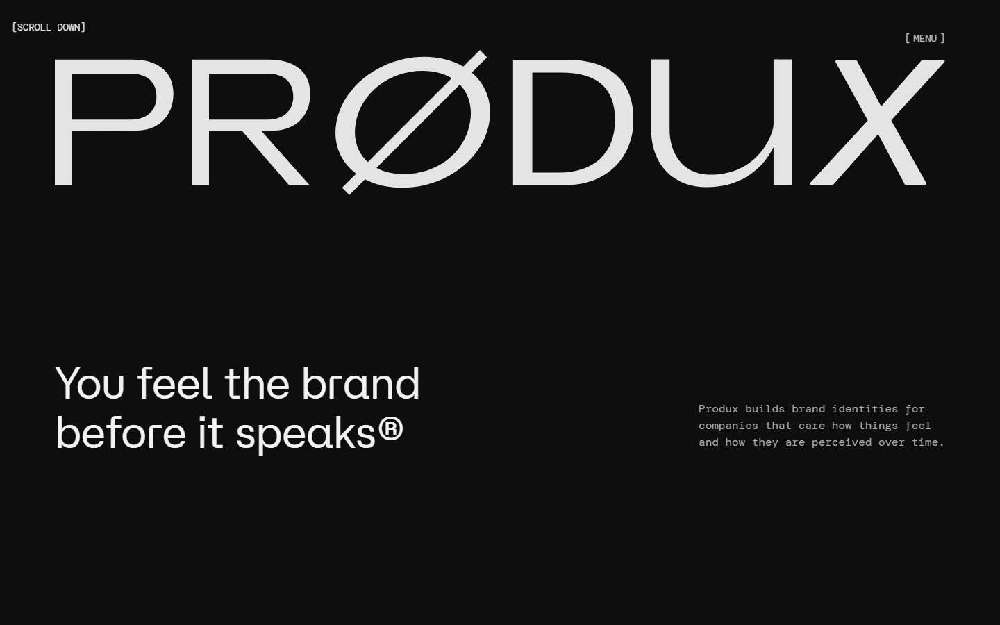

- **Usar quando:** marca, consultoria, algo sério que não quer parecer pesado.
- **Decisões que inspira:** tipografia **gigante em peso leve** (300), que dá
  elegância sem gritar — o oposto do reflexo de usar bold; marcadores em
  colchetes (`[SCROLL DOWN]`, `[ MENU ]`) como moldura de UI; duas famílias
  apenas: grotesca para frase, mono para descrição; quase-preto (#0d0d0d) em
  vez de preto puro.
- **Não copiar:** o cinza médio sobre preto do parágrafo. Para leitura de
  verdade, subir o contraste.

### Miu Miu · A House that we shaped — https://immersivebags.miumiu.com/
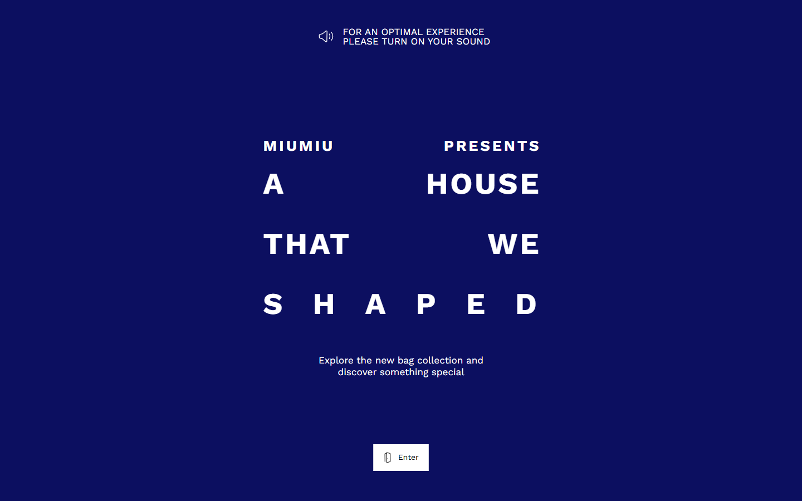

> Este print é a **tela de abertura** (o site é uma experiência com portão de
> entrada e som). Vale como referência tipográfica, não de navegação.

- **Usar quando:** campanha de marca com uma frase curta para ocupar a tela.
- **Decisões que inspira:** palavras distribuídas numa **grade dispersa** —
  alinhadas em colunas invisíveis, com tracking largo, formando bloco sem
  parecer parágrafo; azul-marinho chapado como única cor; frase de apoio
  centralizada e pequena embaixo.
- **Não copiar:** o portão de entrada e o "please turn on your sound".

---

## 5. Produto — bonito porque funciona

É daqui que sai a maior parte do que se constrói aqui. **Padrão para app,
ferramenta, painel e site institucional.**

### Linear — https://linear.app
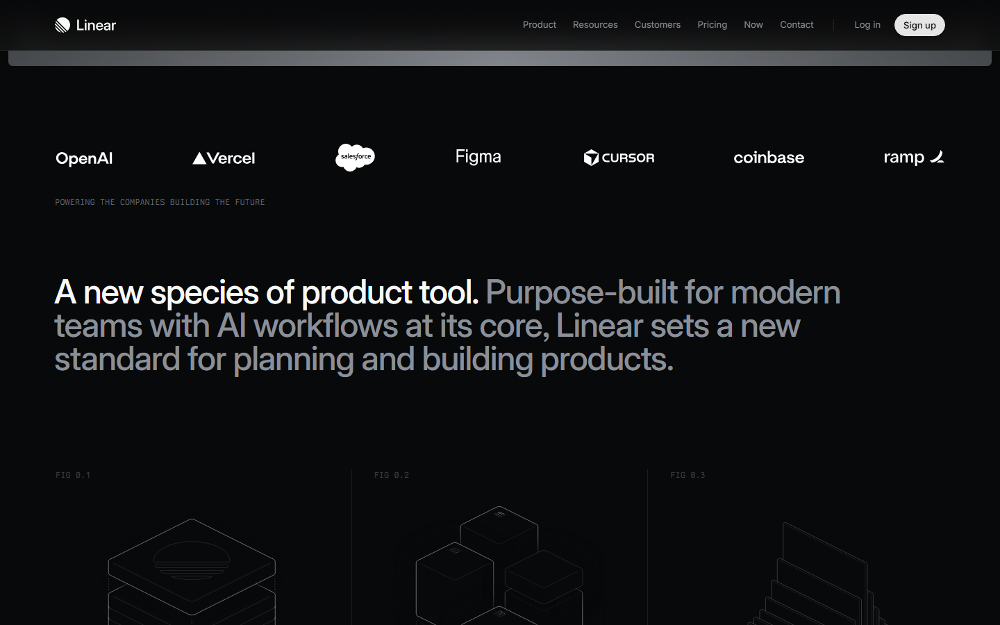
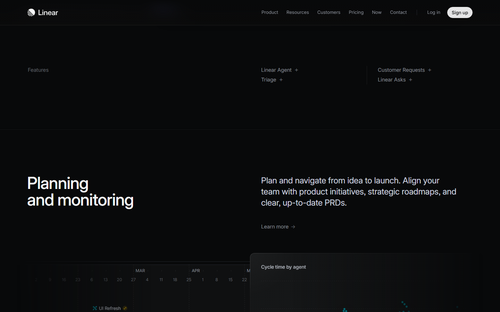

- **Usar quando:** ferramenta com muita informação na tela; qualquer coisa que
  precise de densidade sem virar poluição.
- **Decisões que inspira:**
  - **Frase de duas cores:** a oração principal em branco puro, o resto da
    mesma frase em cinza ~60% — mesma fonte, mesmo tamanho, mesmo peso. Faz
    hierarquia sem aumentar nada.
  - **Escala de cinza com 3–4 níveis de texto** sobre fundo quase preto
    (#08090a), nunca preto puro.
  - **Labels em mono minúsculo** para metadados (`FIG 0.1`,
    `POWERING THE COMPANIES BUILDING THE FUTURE`) — mono só aqui, nunca no corpo.
  - **Grid de 3 colunas com divisores verticais finos** separando blocos de
    conteúdo; ilustração em wireframe (linha fina, sem preenchimento) no lugar
    de screenshot.
  - Faixa de logos de clientes em linha única, todos na mesma altura óptica.
- **Não copiar:** cinza escuro em texto corrido longo. Serve para uma frase de
  apoio; não serve para um parágrafo que alguém precisa ler.

### Vercel — https://vercel.com
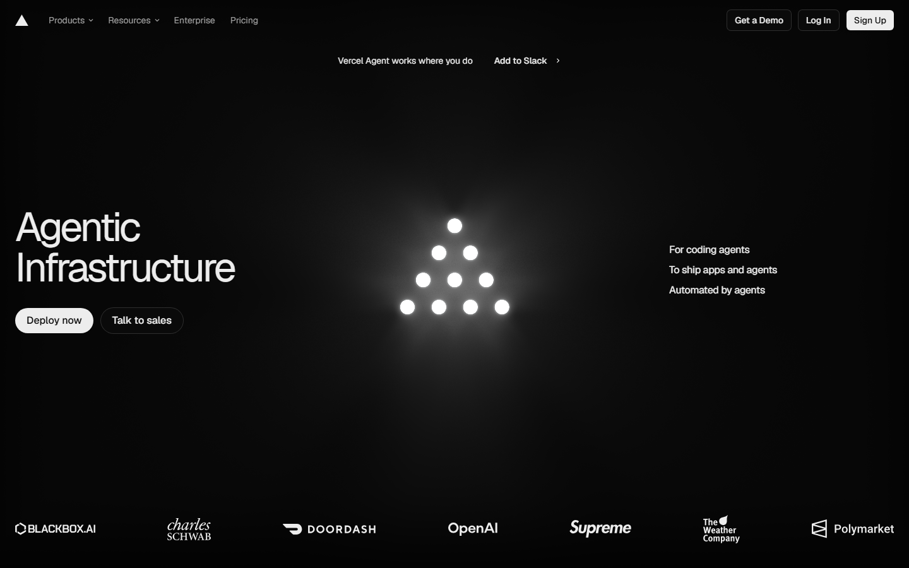
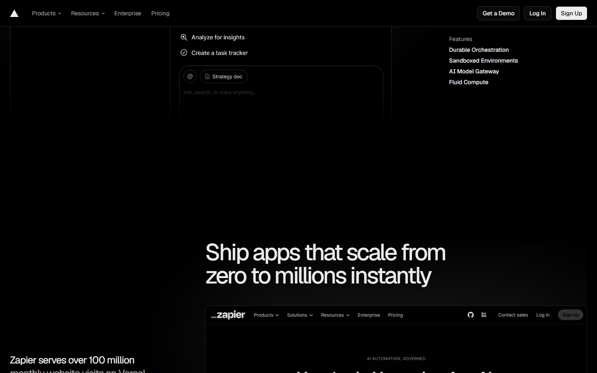

- **Usar quando:** produto técnico que precisa de clareza e de um par de CTAs.
- **Decisões que inspira:** hero em **três colunas** — título + botões à
  esquerda, visual no centro, três bullets curtos à direita; **botão primário
  sólido claro + secundário só contornado**, ambos pill, lado a lado; faixa de
  logos de clientes fixada na base do hero; seções seguintes com um screenshot
  de interface real emoldurado.
- **Não copiar:** o brilho radial do gráfico central. Some em monitor ruim e em
  modo claro, e não carrega informação nenhuma.

### Apple — páginas de produto — https://www.apple.com/macbook-pro/
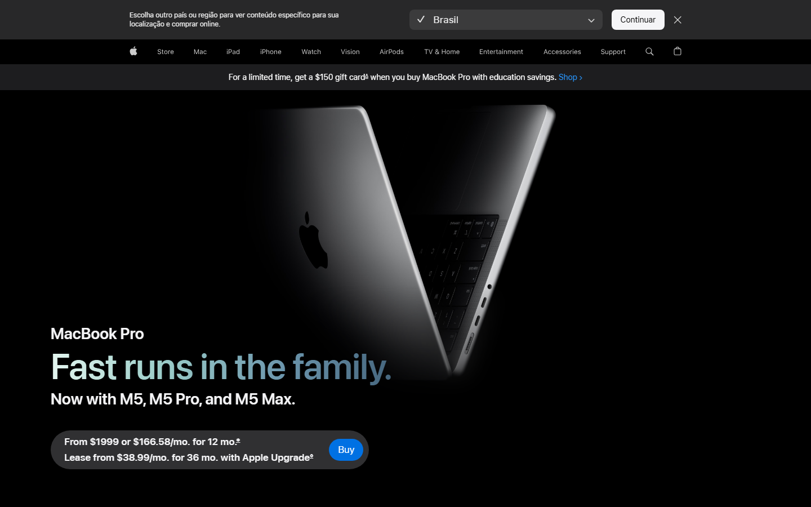
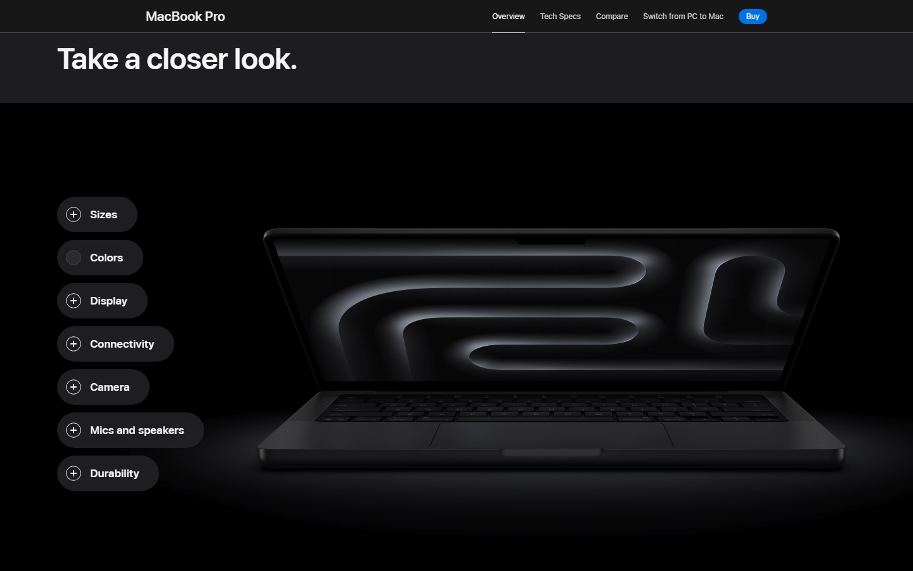

- **Usar quando:** precisa de ritmo de scroll — uma ideia por tela, sem
  atropelo.
- **Decisões que inspira:** **nav secundária sticky do produto** (`Overview /
  Tech Specs / Compare`) aparecendo depois do herói; preço e CTA numa cápsula
  escura única em vez de dois elementos soltos; **chips expansíveis** com `+`
  numa coluna à esquerda e o produto à direita; headline com gradiente sutil
  aplicado em **uma parte da frase**; uma ideia por tela, cada seção com o
  mesmo respiro vertical.
- **Não copiar:** a produção fotográfica. Sem estúdio, tentar imitar aquela luz
  dura em render caseiro fica pior do que uma foto simples e honesta. Pegar o
  **ritmo**, não os recursos.

### Stripe — https://stripe.com
*(sem print — ver seção 7)*

- **Usar quando:** precisa explicar coisa complexa (documentação, API, produto
  com muitos conceitos).
- **Decisões que inspira:** código e explicação lado a lado na mesma altura;
  gradiente usado como assinatura de seção, não como fundo de tudo; navegação
  de documentação com três níveis visíveis sem parecer árvore de arquivos.
- **Não copiar:** a quantidade de gradiente animado no topo.

---

## 6. O que copiar e o que não copiar — regra geral

**Copiar:** ritmo de espaçamento, hierarquia tipográfica, papel da cor, duração
e curva das transições, como o conteúdo é sequenciado no scroll, como os
metadados são tratados.

**Não copiar — em nenhum projeto desta pasta:**

- **Portão de entrada** antes do conteúdo. Exemplo real, capturado:

  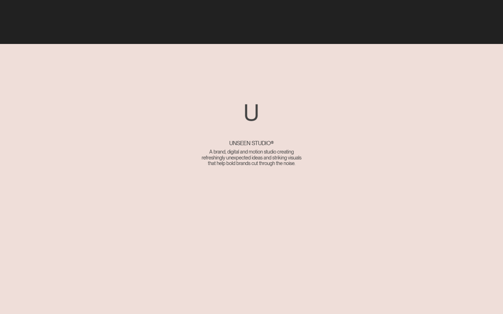

  Isso é a home do Unseen Studio. Não há conteúdo nenhum até clicar. Aceitável
  em vitrine de estúdio que a pessoa visita uma vez; defeito em qualquer coisa
  que se use de novo. O Minh Pham e o Miu Miu fazem o mesmo.
- **Scroll sequestrado** que impede rolar normal (vários da seção Espetáculo
  fazem isso — no print, a página tem 900px de altura e o scroll é falso).
- **Som ligado por padrão**, ou pedido de "ligue o som".
- **Cursor customizado** sem função.
- **Animação que atrasa a primeira leitura.** Animar depois do conteúdo estar
  legível, não antes.
- **Texto com contraste baixo por estilo.**
- **Exigir WebGL** para o site funcionar.

---

## 7. Referências sem print — abrir ao vivo

Estas quatro fazem parte da biblioteca, mas **não têm print válido nesta
máquina**. Nenhuma delas pode ser usada como evidência visual, citada no lugar
de um print, nem entrar na comparação final do passo 4. Para usar qualquer uma,
**abrir o site no navegador normal** e ler dali — ou escolher outra referência.

| Referência | Seção | Por que não tem print |
|---|---|---|
| **Stripe** — https://stripe.com | Produto | O Kaspersky Premium intercepta `stripe.com` (e `docs.stripe.com`) com a tela "Safe Money — abra este site no modo protegido". A captura sai do antivírus, não do site. |
| **Active Theory** — https://activetheory.net | Espetáculo | O site devolve "your browser is not supported" para navegador automatizado. O que aparece é uma tela de erro, não o design — não serve como evidência de nada. |
| **hobro.digital** — https://hobro.digital | Premiado | Está atrás de verificação anti-bot da Cloudflare. Resolver CAPTCHA não é coisa que eu faça. |
| **Uncommon Studio** — https://uncommonstudio.com.au/ | Espetáculo | Não renderiza em navegador automatizado: sai tela preta. Vale como referência de grid firme com quebras planejadas, mas só ao vivo. |

Outra limitação, essa visível nos prints: sites com portão de entrada foram
capturados **no portão** quando o clique automático não funcionou. Está dito no
verbete de cada um.

## 8. Como capturar um print novo

O capturador está em `capturar-print.py`, nesta pasta. Ele sobe o Edge em modo
headless, espera, rola a página para disparar as animações de entrada, esconde
banner de cookie e salva o PNG em 1440×900:

```bash
python .claude/referencias-visuais/capturar-print.py lista.json .claude/referencias-visuais/prints
```

Onde `lista.json` é:

```json
[
  {"arquivo": "produto-exemplo-topo.png", "url": "https://exemplo.com", "espera": 8},
  {"arquivo": "produto-exemplo-secao.png", "url": "https://exemplo.com", "espera": 8, "y": 1400}
]
```

Campos: `espera` (segundos após carregar), `y` (rolar até esta posição antes de
capturar — só funciona em site com scroll real), `clique` (lista de textos de
botão para clicar antes, ex.: `["enter"]`) e `espera_clique`.

**Nome do arquivo:** `<secao>-<site>-<oquê>.png`, tudo minúsculo com hífen.
Seções: `espetaculo`, `premiado`, `produto`, `antipadrao`.

Print novo **só entra na biblioteca junto com o texto dele** — uso adequado,
decisões que inspira e o que não copiar. Print sem esses três vira enfeite.

---

## 9. Galerias — para buscar referência nova

- Awwwards — https://www.awwwards.com/websites/sites_of_the_day/
- Awwwards, filtro WebGL — https://www.awwwards.com/inspiration_search/webgl/
- Recent.design (antigo Godly) — https://recent.design/

Ao trazer coisa nova daqui: capturar o print, classificar em Espetáculo /
Premiado / Produto, e escrever as três partes do verbete. Referência que entra
só como link não conta.
